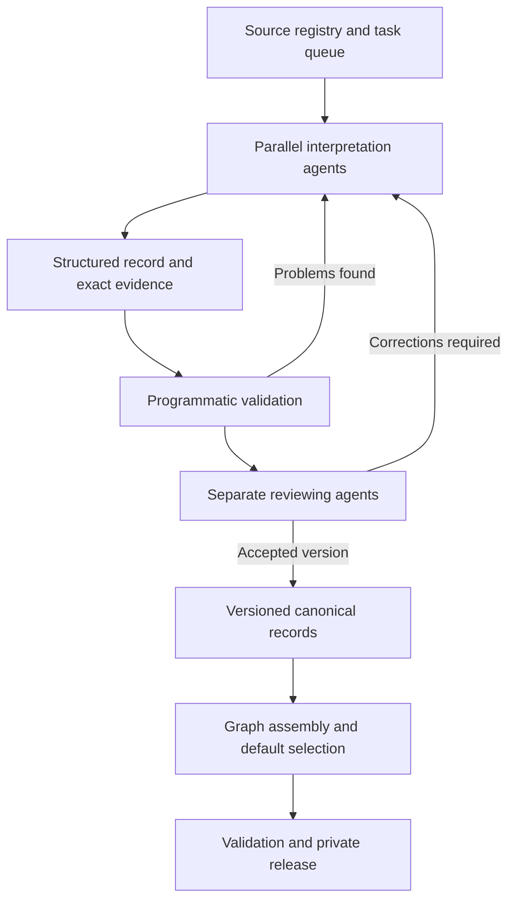

# Ur III

I'm trying to reconstruct Ur III from cuneiform accounting tablets. This is work in progress. If you want to help, contact me!

## Some background

First of all, here's some history:

During and following the decline of the Akkadian empire around 2200-2150BCE, Southern Mesopotamia was left politically fragmented, and around 2112 BCE a leader called Ur-Nammu established a dynasty at  Ur. It's generally talked about as the Third Ur Dynasty, or Ur III, since it follows the first Ur city-state that was ruled by the First Ur Dynasty, and the Second Ur Dynasty about which almost nothing is known. Ur-Nammu ruled for 18 years until his death in 2095 BCE, and during his lifetime he was successful in reuniting the city states of Southern Mesopotamia under Ur rule. He also commissioned one of the world's first law codes, 300 years before Hammurabi, and built the Great Ziggurat, a massive stepped temple complex the remains of which remain today. 

Ur-Nammu's son, Shulgi, ruled for 48 years after Ur-Nammu's death from 2094-2047 BCE. Shulgi's great innovation was to standardise the systems used for accounting and measure. During Shulgi's rule, Ur established uniform units of measurement (one *sila* was roughly a litre of grain, and one *gur* was 300 sila). Just as importantly, systems for tracking goods, labour and inventories, and accounting were standardised. The accounting system of Ur moved from consisting mostly of receipts of individual transactions or agreements, the accounting systems under Shulgi brought together transactions over months or years, calculating the total resources entrusted to an institution / official, subtracting total expenditures, and recording the outstanding balance. These remaining balances were increasingly carried forward into subsequent accounting periods. 

This accounting system meant that the kings of Ur could organise large parts of the economy. The kingdom was divided into roughly 20-22 core provinces, each of which had a governor (the *ensi*) who ran local institutions and was responsible for meeting the obligations to the royal government. Provinces were assigned quotas of goods and labour to contribute from the royal government based on their economic capacity, and these contributions were collected at royal distribution centres to be redistributed to the institutions that needed them.  

But to make all this work took an incredible accounting effort. Every delivery, transfer, or assignment was recorded by scribes on a small clay tablet. Foremen would report to accountants with the total workmen-days and the work completed. Many of these tablets were then enclosed in a second layer of clay forming an envelope. These records were then sent to provincial administrative offices, and some to the royal capital, for verification and accounting, and here individual receipts were aggregated into monthly or annual accounts showing how much an institution/individual had spent, received, and still owed relative to their obligations. Deficits were carried forward into the next accounting cycle. Then in aggregate, these accounts showed provincial governers whether or not they were meeting their obligation to the royal government, while the royal government could track contributions from the provinces and coordinate the redistribution of resources across the kingdom.

Ur III was first discovered in 1853 by John George Taylor, who uncovered the first Ur tablets when investigating Tell el-Muqayyar. Over the roughly 108 year lifespan of Ur III, we've recovered over 120,000 Ur III administrative tablets and other documents. Most (~77% of BDTNS) of these texts come from three main archeological sites: Girsu, which was the administrative centre of the wealthy Lagash province, Umma, which was the capital of the Umma province, and Puzriš-Dagān, which was a royal administrative centre established under Shulgi for livestock.

Thanks to the tremendous research effort of generations of assyriologists, we have transliterations for around 75,000 Ur III administrative tablets. Almost all of these transliterations have been digitised by the BDTNS project. 


## What I'm working on

Individual tablets 
But to do research and learn about Ur III, the problem is to intepret these sources, There are only a few hundred researchers alive today who can interpret individual sources and thus do productive research on BDTNS.

To do this requires training in cuneiform, and experience with the texts. Using AI (a mixture of gpt-5.6 sol, gpt-6.1 sol and gpt-6 astra were used) this project uses AI to interpret all 19,000 Drehem texts, and put them into a canonical format, describing participants, their relationships. This opens the doors to a whole new category of assyriology research, where we can now work over these structured intepretation documents and the relationships between them quickly and efficiently, rather than spending years reconstructing individual source texts.

We are expanding this method; this project will soon contain canonical records for all non-ATF sources across BDTNS. I am currently expanding source coverage to include Puzriš-Dagān, . 

## How I'm doing it

A shared task queue distributed source work across parallel interpretation agents and a separate reviewer pool. The queue tracked the source being worked on and the version submitted for review, so parallelism did not mean untracked edits to the same record. Interpretation and review could proceed on different sources at the same time.



The diagram shows the standard review route. A defined cohort of 623 sources used an authorised author-self-check route; the per-record history preserves that distinction. Corrections produced new versions, and the graph was assembled from explicitly selected record versions. The released repository contains the result and its scientific provenance, without requiring the task system that produced it.

## The interpretation method

We used AI agents to read individual sources into a common record structure. The task was to interpret the whole supplied text, including its closing clauses, seals and envelopes, and record what its statements mean. Code provided stable identifiers, exact evidence coordinates, structural checks and graph assembly. A separate agent-review workflow checked interpretations against the bound source and returned corrections. Each record retains its authorship, review decisions and interpretive history. The methods and provenance documents explain the review process and its recorded exceptions.

The resulting record contains much more than a transcription with names and numbers attached. It distinguishes a recipient from a witness, a quantity from a rate, a written total from a calculated check, and a person mentioned in a seal from a person participating in an entry. It records which details a subtotal includes, where a date applies, and when two parts of a document represent the same material. Interpretive alternatives have explicit targets and reasons.

Every such statement can be traced to the exact version of its source. The text, its structured interpretation and the default used for analysis are preserved separately. That makes it possible to improve an interpretation without losing the evidence from which it was made.

The [method](docs/METHODS.md) describes this process in full, from source selection through interpretation, review and assembly.

## What can you do with it

The collection can be queried by documentary content: commodities, quantities, people as written occurrences, institutions, places, dates, roles and relationships. Results retain the source and field that produced them. You can move from a corpus-wide search to a particular assertion and then to the passage and reasoning that support it.

Consider an account with detailed entries and a total. A useful representation must say which measurements belong to that total. Otherwise a program can find all the numbers but cannot know what to add. Likewise, a tablet and its envelope may describe the same goods. Counting each representation as a new delivery would change the history. In P105740, the record makes the membership of the two one-sheep details in the two-sheep total explicit and preserves the documentary relationship between the witnesses.

This is the work the graph makes reusable. It exposes the interpretation of a document in a form that can be checked and manipulated, while keeping its scope. It does not resolve all people with similar names into global identities or declare that every pair of related documents records one transaction. Those are research questions to pursue over the records.

The current canonical records contain 172,723 entries, 149,429 mentions, 171,251 relation objects and 165,959 measurements. They also contain 251,231 qualifications and 246,756 reasoning objects. These counts describe the preserved records, not distinct historical events or people.


## Start using it

Clone the private repository using an account with access. The reader requires Python 3.11 or later and only the standard library. It needs no database server, external service or original production workspace.

```sh
git clone https://github.com/caiusdfolkerts/girsu.git
cd girsu
python girsu.py verify
python girsu.py record P105740
```

From Python, open a record or inspect a particular field with its evidence and qualifications:

```python
from girsu import Graph

g = Graph()
record = g.record("P105740")

field = g.research_value("P105740", "/entries/2/membership")
print(field["value"])
print(field["qualifications"])
print(field["branches"])
```

The [query guide](docs/COOKBOOK.md) shows how to retrieve documents, dates, institution mentions, commodities, native relations and personal occurrences, and how to export the results without losing provenance. The [data dictionary](docs/DATA_DICTIONARY.md) describes the record structure. [Reading the graph](docs/SEMANTICS.md) explains quantities, nulls, dates, identity and documentary scope.

## The corpus

Girsu was a Sumerian city at modern Tello in southern Iraq. It belonged to the state of Lagash, whose name can also refer to a separate city at modern al-Hiba. The principal setting of this collection is the Ur III period, the Third Dynasty of Ur, broadly the twenty-first century BCE.

The surviving documents show administrative life at close range: receipts, accounts, expenditure, workforces, inventories, legal matters and correspondence. They describe people acting in institutional roles, the movement and allocation of goods, and the recording of responsibility. They are especially valuable for studying how administration worked because they preserve individual entries and decisions rather than only royal accounts of government.

In this release, 8,979 current records are classified as accounts, 3,494 as receipts and 1,090 as expenditure. There are also personnel lists, inventories, legal records and letters. Other records retain a less specific or unresolved genre. A site's administrative corpus is not one institution's archive, and a place mentioned inside a text is not necessarily where that text originated.

## Where the texts came from

The project's upstream acquisition code records a collection assembled from CDLI catalogue data and scholarly transliterations. The Girsu corpus was reconciled against a preserved catalogue export by its Girsu site-group field. It contains 30,256 catalogue IDs: 19,208 with saved ATF text and 11,048 without it. The latter are retained as a documentary appendix, not represented as interpreted texts.

CDLI is the Cuneiform Digital Library Initiative. BDTNS, the Database of Neo-Sumerian Texts, is a closely related scholarly resource and part of the editorial setting of this material; the project also used it for a limited earlier comparison. BDTNS was not the direct download source for the whole release. ATF is the transliteration format, not a separate ancient archive. These distinctions, the acquisition evidence and the underlying scholarly work are explained in [Sources](docs/SOURCES.md).

There are 18,409 current canonical records and three explicitly archival records. The remaining registered sources retain their documented dispositions. This is a defined digital corpus with recorded coverage, not a claim to possess every surviving Girsu text or to have interpreted every catalogue entry.

## Checking and extending the work

The source texts and canonical record bytes are preserved with hashes. The release manifest binds the files, and the tests exercise the reader's default selection, evidence access, searches and graph behaviour. The original release passed 27 consumer and query-example tests, alongside independent preservation and package audits. [Validation](docs/VALIDATION.md) explains what those checks establish, and [Provenance](docs/PROVENANCE.md) records the populations, version history and review distinctions.

Girsu provides the interpreted source layer for a research programme: a collection that can be searched systematically, investigated at the level of individual claims, and extended through new historical work.
