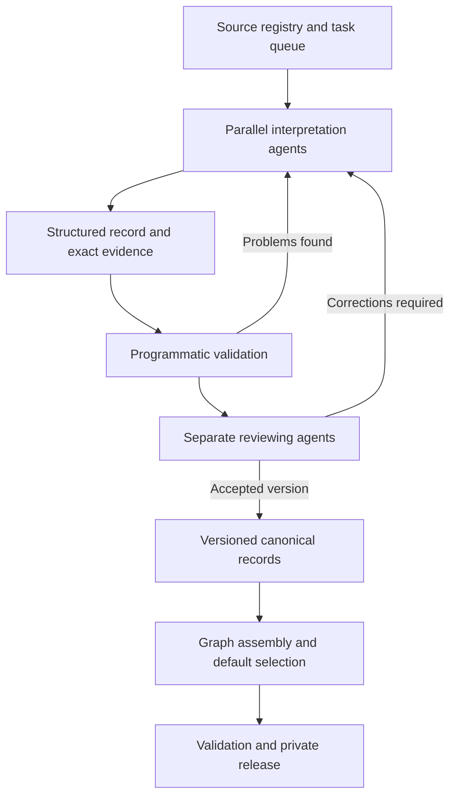

# Reconstructing Ur III

The Ur III sumerian administration that governed southern Mesopotamia from 2112-2004 BCE was one of the most beaurocratic states of human history. Over 108 years and across 23 core provinces, archeology has recovered 120,000 Ur III administrative tablets and related documents. 

The majority (~77% of BDTNS) of these texts come from three archeological sites: Girsu (Tello, Iraq), Umma (Tell Jokha, Iraq) and Puzriš-Dagān (Drehem, Iraq). Ur III was first discovered in 1853 by John George Taylor, who investigated Tell el-Muqayyar and uncovered the first Ur transcriptions. Arguably (and geographically) the centre of the Ur III administration, and the first to be discovered is Girsu, where Ernest de Sarvec discovered 30,000 administrative tablets in 1894. 

Historians have been studying trying to reconstruct the economic and administrative practices of Ur III by studying administrative tablets since de Sarvec's first discovery. Tablets are distributed accross museums and private collections, with many at the British Museum and the Louvre, and are written in cuneiform. Thanks to the tremendous research effort of thousands of assyriologists over the last century and a half, the majority of Ur III administrative records have been transcribed. Since 2013, they have been digitised and collected by the BDTNS project. 

Individual tablets 
But to do research and learn about Ur III, the problem is to intepret these sources, There are only a few hundred researchers alive today who can interpret individual sources and thus do productive research on BDTNS.

To do this requires training in cuneiform, and experience with the texts. Using AI (a mixture of gpt-5.6 sol, gpt-6.1 sol and gpt-6 astra were used) this project uses AI to interpret all 19,000 Drehem texts, and put them into a canonical format, describing participants, their relationships. This opens the doors to a whole new category of assyriology research, where we can now work over these structured intepretation documents and the relationships between them quickly and efficiently, rather than spending years reconstructing individual source texts.

We are expanding this method; this project will soon contain canonical records for all non-ATF sources across BDTNS. I am currently expanding source coverage to include Puzriš-Dagān, I plan to make the agent harness that was used in the development of this project open source so that anyone can make contributions as we expand progres. 

## The agentic pipeline

A shared task queue distributed source work across parallel interpretation agents and a separate reviewer pool. The queue tracked the source being worked on and the version submitted for review, so parallelism did not mean untracked edits to the same record. Interpretation and review could proceed on different sources at the same time.



The diagram shows the standard review route. A defined cohort of 623 sources used an authorised author-self-check route; the per-record history preserves that distinction. Corrections produced new versions, and the graph was assembled from explicitly selected record versions. The released repository contains the result and its scientific provenance, without requiring the task system that produced it.

## The interpretation method

We used AI agents to read individual sources into a common record structure. The task was to interpret the whole supplied text, including its closing clauses, seals and envelopes, and record what its statements mean. Code provided stable identifiers, exact evidence coordinates, structural checks and graph assembly. A separate agent-review workflow checked interpretations against the bound source and returned corrections. Each record retains its authorship, review decisions and interpretive history. The methods and provenance documents explain the review process and its recorded exceptions.

The resulting record contains much more than a transcription with names and numbers attached. It distinguishes a recipient from a witness, a quantity from a rate, a written total from a calculated check, and a person mentioned in a seal from a person participating in an entry. It records which details a subtotal includes, where a date applies, and when two parts of a document represent the same material. Interpretive alternatives have explicit targets and reasons.

Every such statement can be traced to the exact version of its source. The text, its structured interpretation and the default used for analysis are preserved separately. That makes it possible to improve an interpretation without losing the evidence from which it was made.

The [method](docs/METHODS.md) describes this process in full, from source selection through interpretation, review and assembly.

## What this lets you do

The collection can be queried by documentary content: commodities, quantities, people as written occurrences, institutions, places, dates, roles and relationships. Results retain the source and field that produced them. You can move from a corpus-wide search to a particular assertion and then to the passage and reasoning that support it.

Consider an account with detailed entries and a total. A useful representation must say which measurements belong to that total. Otherwise a program can find all the numbers but cannot know what to add. Likewise, a tablet and its envelope may describe the same goods. Counting each representation as a new delivery would change the history. In P105740, the record makes the membership of the two one-sheep details in the two-sheep total explicit and preserves the documentary relationship between the witnesses.

This is the work the graph makes reusable. It exposes the interpretation of a document in a form that can be checked and manipulated, while keeping its scope. It does not resolve all people with similar names into global identities or declare that every pair of related documents records one transaction. Those are research questions to pursue over the records.

The current canonical records contain 172,723 entries, 149,429 mentions, 171,251 relation objects and 165,959 measurements. They also contain 251,231 qualifications and 246,756 reasoning objects. These counts describe the preserved records, not distinct historical events or people.

## One default reading

Ordinary queries use one consistent reading of each record. The default policy selects a branch when its implemented rules establish a supported preference; otherwise it holds the affected target null. Results retain the applicable qualifications and pointers to explanations and alternatives.

The evidence is never deleted to make this view simpler. Restored readings retain their marks and justification. Disputed names remain disputed. A written total is not changed merely because a different number would make an account balance. The [default policy](docs/DEFAULT_POLICY.md) explains the implemented rules and their scope.

All record, search and graph methods use this same default. Explicit evidence methods let you inspect the preserved canonical interpretation and original text when you need to examine a decision.

## Start using it

Clone the private repository using an account with access. The reader requires Python 3.11 or later and only the standard library. It needs no database server, external service or original production workspace.

```sh
git clone https://github.com/caiusdfolkerts/girsu.git
cd girsu
python girsu.py verify
python girsu.py record P105740
```

From Python, open a record or inspect a particular field with its evidence and qualifications:

```python
from girsu import Graph

g = Graph()
record = g.record("P105740")

field = g.research_value("P105740", "/entries/2/membership")
print(field["value"])
print(field["qualifications"])
print(field["branches"])
```

The [query guide](docs/COOKBOOK.md) shows how to retrieve documents, dates, institution mentions, commodities, native relations and personal occurrences, and how to export the results without losing provenance. The [data dictionary](docs/DATA_DICTIONARY.md) describes the record structure. [Reading the graph](docs/SEMANTICS.md) explains quantities, nulls, dates, identity and documentary scope.

## The corpus

Girsu was a Sumerian city at modern Tello in southern Iraq. It belonged to the state of Lagash, whose name can also refer to a separate city at modern al-Hiba. The principal setting of this collection is the Ur III period, the Third Dynasty of Ur, broadly the twenty-first century BCE.

The surviving documents show administrative life at close range: receipts, accounts, expenditure, workforces, inventories, legal matters and correspondence. They describe people acting in institutional roles, the movement and allocation of goods, and the recording of responsibility. They are especially valuable for studying how administration worked because they preserve individual entries and decisions rather than only royal accounts of government.

In this release, 8,979 current records are classified as accounts, 3,494 as receipts and 1,090 as expenditure. There are also personnel lists, inventories, legal records and letters. Other records retain a less specific or unresolved genre. A site's administrative corpus is not one institution's archive, and a place mentioned inside a text is not necessarily where that text originated.

## Where the texts came from

The project's upstream acquisition code records a collection assembled from CDLI catalogue data and scholarly transliterations. The Girsu corpus was reconciled against a preserved catalogue export by its Girsu site-group field. It contains 30,256 catalogue IDs: 19,208 with saved ATF text and 11,048 without it. The latter are retained as a documentary appendix, not represented as interpreted texts.

CDLI is the Cuneiform Digital Library Initiative. BDTNS, the Database of Neo-Sumerian Texts, is a closely related scholarly resource and part of the editorial setting of this material; the project also used it for a limited earlier comparison. BDTNS was not the direct download source for the whole release. ATF is the transliteration format, not a separate ancient archive. These distinctions, the acquisition evidence and the underlying scholarly work are explained in [Sources](docs/SOURCES.md).

There are 18,409 current canonical records and three explicitly archival records. The remaining registered sources retain their documented dispositions. This is a defined digital corpus with recorded coverage, not a claim to possess every surviving Girsu text or to have interpreted every catalogue entry.

## Checking and extending the work

The source texts and canonical record bytes are preserved with hashes. The release manifest binds the files, and the tests exercise the reader's default selection, evidence access, searches and graph behaviour. The original release passed 27 consumer and query-example tests, alongside independent preservation and package audits. [Validation](docs/VALIDATION.md) explains what those checks establish, and [Provenance](docs/PROVENANCE.md) records the populations, version history and review distinctions.

Girsu provides the interpreted source layer for a research programme: a collection that can be searched systematically, investigated at the level of individual claims, and extended through new historical work.
