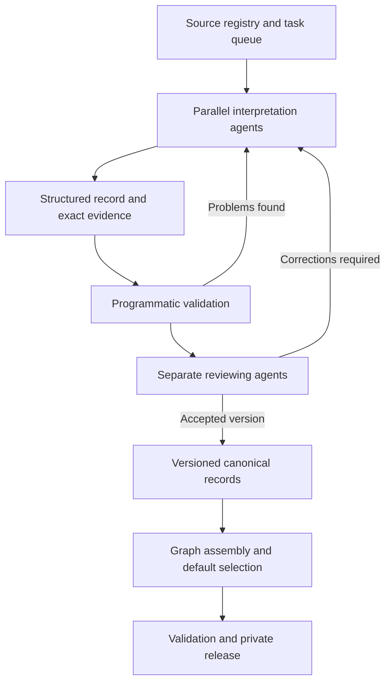

# Ur III

I'm trying to reconstruct Ur III from cuneiform accounting tablets. This is work in progress. If you want to help, contact me!

## Some background

First of all, here's some history:

During and following the decline of the Akkadian empire around 2200-2150BCE, Southern Mesopotamia was left politically fragmented, and around 2112 BCE a leader called Ur-Nammu established a dynasty at  Ur. It's generally talked about as the Third Ur Dynasty, or Ur III, since it follows the first Ur city-state that was ruled by the First Ur Dynasty, and the Second Ur Dynasty about which almost nothing is known. Ur-Nammu ruled for 18 years until his death in 2095 BCE, and during his lifetime he was successful in reuniting the city states of Southern Mesopotamia under Ur rule. He also commissioned one of the world's first law codes, 300 years before Hammurabi, and built the Great Ziggurat, a massive stepped temple complex the remains of which remain today. 

Ur-Nammu's son, Shulgi, ruled for 48 years after Ur-Nammu's death from 2094-2047 BCE. Shulgi's great innovation was to standardise the systems used for accounting and measure. During Shulgi's rule, Ur established uniform units of measurement (one *sila* was roughly a litre of grain, and one *gur* was 300 sila). Just as importantly, systems for tracking goods, labour and inventories, and accounting were standardised. The accounting system of Ur moved from consisting mostly of receipts of individual transactions or agreements, the accounting systems under Shulgi brought together transactions over months or years, calculating the total resources entrusted to an institution / official, subtracting total expenditures, and recording the outstanding balance. These remaining balances were increasingly carried forward into subsequent accounting periods. 

This accounting system meant that the kings of Ur could organise large parts of the economy. The kingdom was divided into roughly 20-22 core provinces, each of which had a governor (the *ensi*) who ran local institutions and was responsible for meeting the obligations to the royal government. Provinces were assigned quotas of goods and labour to contribute from the royal government based on their economic capacity, and these contributions were collected at royal distribution centres to be redistributed to the institutions that needed them.  

But to make all this work took an incredible accounting effort. Every delivery, transfer, or assignment was recorded by scribes on a small clay tablet. Foremen would report to accountants with the total workmen-days and the work completed. Many of these tablets were then enclosed in a second layer of clay forming an envelope. These records were then sent to provincial administrative offices, and some to the royal capital, for verification and accounting, and here individual receipts were aggregated into monthly or annual accounts showing how much an institution/individual had spent, received, and still owed relative to their obligations. Deficits were carried forward into the next accounting cycle. Then in aggregate, these accounts showed provincial governers whether or not they were meeting their obligation to the royal government, while the royal government could track contributions from the provinces and coordinate the redistribution of resources across the kingdom.

------

Ur III was first discovered in 1853 by John George Taylor, who uncovered the first Ur tablets when investigating Tell el-Muqayyar. Over the roughly 108 year lifespan of Ur III, we've recovered over 120,000 Ur III administrative tablets and other documents. Most (~77% of BDTNS) of these texts come from three main archeological sites: Girsu, which was the administrative centre of the wealthy Lagash province, Umma, which was the capital of the Umma province, and Puzriš-Dagān, which was a royal administrative centre established under Shulgi for livestock.

Thanks to the tremendous research effort of generations of assyriologists, we've transliterations for around 75,000 Ur III administrative tablets. Almost all of these transliterations have been digitised by the BDTNS project. 


## What I'm working on

But this is only so useful. These transliterations are all written in cuneiform, and using the particular practices of cuneiform that were used by Ur III accountants. Being able to read them requires years of training, and then more years of experience and years of time. Many are complicated enough that it can take an expert days to extract the important information from them. 

The problem is that individual tablets generally aren't very useful for learning new things about Ur III - individual tablets have lots of detail about a particular account or transaction, or even an aggregate, but when we want to learn about Ur III what we are interested are the big questions: how did taxation work? why did the empire collapse? was it entirely centrally planned, or were markets used in some form? how did the accounting practices change over the course of the dynasty? And to answer questions like those, you need to do research over tens of thousands of tablets, and look for trends, and test hypotheses and so on. 

But since interpreting (i.e. taking a cuneiform text, and translating / extracting the important things that happen in that text) tablets takes so much time, not just translating but also reconstructing the accounting that happens, assyriology research is generally a multi-year process of finding a question with the right scope, finding texts relevant to it, interpreting and extracting structure from those texts, and then using that structure to answer the question.

But we could learn so much more, and we could be so much more ambitious if we had some database of structured interpretations for these tablets. We already have all the data in BDTNS - the problem is to extract the structure from it. That's what I've been trying to do here. 

I've been using AI (mostly GPT-5.6/6.1 Sol, though I experimented with open models) to interpret 19,000 texts from the Girsu site, and to put this intepretation into a canonical record that is sufficiently structured and reliable that we can run code (eg. for doing corpus-wide accounting) and do research over the space of canonical records, rather than the tablets. I'm currently reaching out to assyriologists to assess and improve the accuracy of these interpretations, so if you're an assyriologist and you're interested in this work, please contact me! (at caiusdfolkerts@gmail.com)

## How I'm doing it

I worked over 19,000 Girsu texts from the CDLI database. 

Here's a rough overview of the pipeline I built. Using code, I divided source interpretation into tasks (where one task might be a batch of 80 sources), and the code was written to extract similarities / flag keywords such that batches consisted of tablets that might need similar methods for interpretation, in the hope that agents would discover patterns and figure out how to be more efficient. I tried to prompt this kind of self-improvement into the process, with mixed success. These tasks were then put into a shared task queue, to avoid agents being idle, that distributed source work across parallel interpretation agents and a separate reviewer pool. This queue also keeps track of the source being worked on and the version submitted for review. If you're into such things, I had ChatGPT draw a flowchart of the process below. 


The input for an authoring task was a CDLI transliterated text, together with that text's generated SHA-256 hash. Code provided stable identifiers, exact evidence coordinates, structural checks and graph assembly. A separate reviewer workflow checked interpretations against the bound source and returned corrections. Each record retains its authorship, review decisions and interpretive history. 

At the start of a context, an agent was given a prompt document which we iterated on over time (by asking agents that made mistakes why they thought they made the mistake, for areas where the task / expected output wasn't described clearly enough), based on repeated failures and mistakes. Separately, whenever reviewer agents found a mistake in a researcher agent's work, the researcher agent was instructed to write to an individual document, some of which became part of the next prompt, the mistake and how to update its policy to not make such mistakes in the future. This saw a significant decrease in reviewer returns, going from ~20% to ~7%. 

Importantly, researcher agents were instructed to preserve uncertainty, for example in missing optional structure, an explicit null due to broken transliteration, or qualifications to its conclusion. Such qualifications were included as a dedicated reasoning section of the records. In cases where there was sufficient ambiguity present for there to be two possible interpretations, the final records contained both records. For the purposes of this pilot, I decided it was better to be conservative about accepting potentially false interpretations. 

The resulting record contains much more than a transcription with names and numbers attached. It distinguishes a recipient from a witness, a quantity from a rate, a written total from a calculated check, and a person mentioned in a seal from a person participating in an entry. It records which details a subtotal includes, where a date applies, and when two parts of a document represent the same material. Interpretive alternatives have explicit targets and reasons.

Every such statement can be traced to the exact version of its source. The text, its structured interpretation and the default used for analysis are preserved separately. That makes it possible to improve an interpretation without losing the evidence from which it was made.

The review workflow then asked a separate agent to examine the whole bound source and its structured meaning. The review contract required confirmation that the complete original was reviewed, that the structured meaning was checked and that the qualifications were checked. Particular attention is paid to attachment, operators and units, documentary stage, arithmetic membership and the justification of adopted inferences.

Despite being inefficient, mistakes were sent back to the researchers directly to correct themselves, in hopes of inducing self improvement and decreased rates of returns. 

The data_dictionary.md file details the structure of the canonical records. 
The prompts that were given to researchers and reviewers can also be found in this repo. 

## What I've produced.

I've run this research-review pipeline over 19,000 source texts from the Girsu site, taking roughly one-and-a-half months in total, and producing structured documents in the canonical record format detailed in data_dictionary.md extracting 

The collection can be queried by documentary content: commodities, quantities, people as written occurrences, institutions, places, dates, roles and relationships. Results retain the source and field that produced them. You can move from a corpus-wide search to a particular assertion and then to the passage and reasoning that support it.

Consider an account with detailed entries and a total. A useful representation must say which measurements belong to that total. Otherwise a program can find all the numbers but cannot know what to add. Likewise, a tablet and its envelope may describe the same goods. Counting each representation as a new delivery would change the history. In P105740, the record makes the membership of the two one-sheep details in the two-sheep total explicit and preserves the documentary relationship between the witnesses.

This is the work the graph makes reusable. It exposes the interpretation of a document in a form that can be checked and manipulated, while keeping its scope. It does not resolve all people with similar names into global identities or declare that every pair of related documents records one transaction. Those are research questions to pursue over the records.

The current canonical records contain 172,723 entries, 149,429 mentions, 171,251 relation objects and 165,959 measurements. They also contain 251,231 qualifications and 246,756 reasoning objects. These counts describe the preserved records, not distinct historical events or people.


## Start using it

Clone the private repository using an account with access. The reader requires Python 3.11 or later and only the standard library. It needs no database server, external service or original production workspace.

```sh
git clone https://github.com/caiusdfolkerts/girsu.git
cd girsu
python girsu.py verify
python girsu.py record P105740
```

From Python, open a record or inspect a particular field with its evidence and qualifications:

```python
from girsu import Graph

g = Graph()
record = g.record("P105740")

field = g.research_value("P105740", "/entries/2/membership")
print(field["value"])
print(field["qualifications"])
print(field["branches"])
```

The [query guide](docs/COOKBOOK.md) shows how to retrieve documents, dates, institution mentions, commodities, native relations and personal occurrences, and how to export the results without losing provenance. The [data dictionary](docs/DATA_DICTIONARY.md) describes the record structure. [Reading the graph](docs/SEMANTICS.md) explains quantities, nulls, dates, identity and documentary scope.

Girsu provides the interpreted source layer for a research programme: a collection that can be searched systematically, investigated at the level of individual claims, and extended through new historical work.
